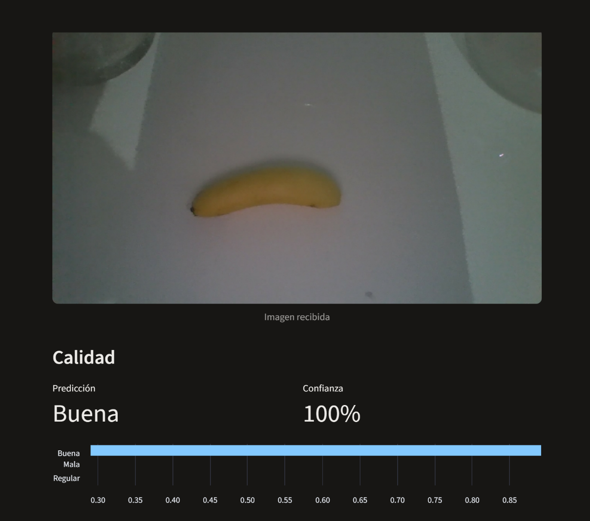
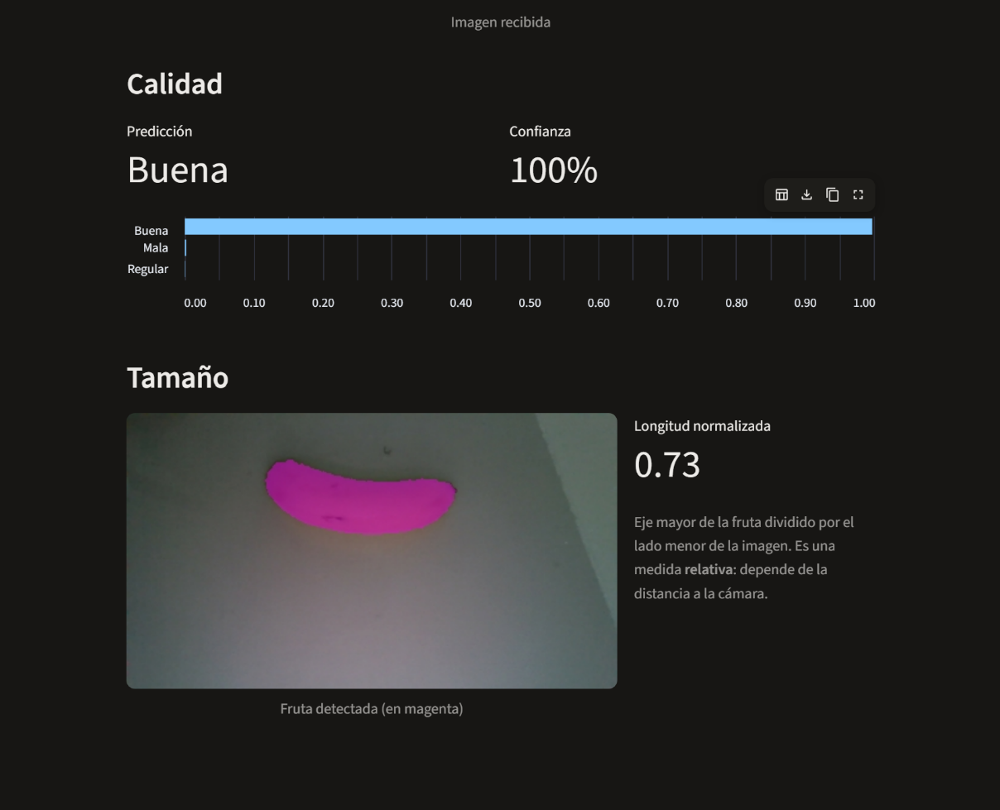
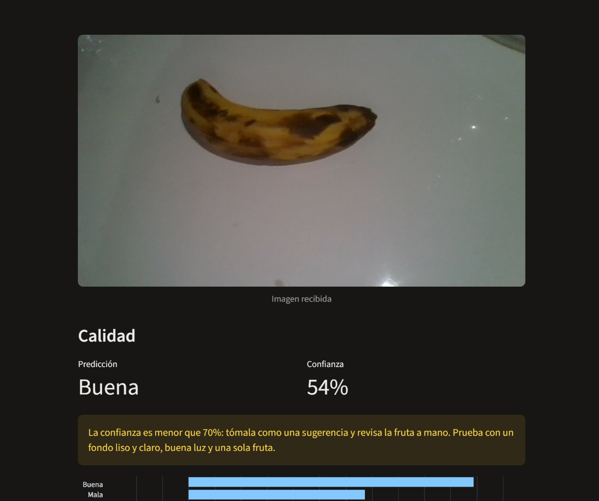
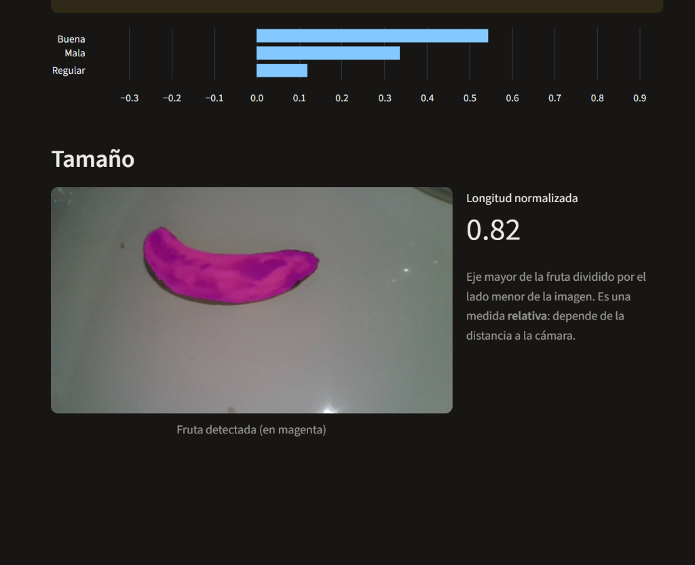

# Prueba manual de cámara — J2

- Responsable: Juan Pablo Bello.
- Fecha: 26 de noviembre de 2026.
- Entorno: Windows, Brave, Python 3.11.9, Streamlit 1.67.0, TensorFlow 2.21.0 (CPU).
- Commit base descargado: `6d3a1e1`.
- Comando: `python -m streamlit run 06_despliegue/app.py`.
- Pruebas automáticas: 112 exitosas, 8 advertencias, 46,16 s.
- Origen de las imágenes: cámara, según reporte del responsable; diálogo de permiso y selector de origen no capturados. Versión exacta de Windows y Brave no registrada.

## Resultados observados

| Caso | Calidad esperada por el responsable | Predicción | Confianza mostrada | Longitud normalizada | Advertencia < 70 % |
|---|---|---|---|---|---|
| Banano en buen estado | Buena | Buena | 100 % | 0,73 | No visible |
| Banano con defectos | Regular | Buena | 54 % | 0,82 | Sí |

La aplicación recibió las imágenes y mostró calidad, confianza, probabilidades, segmentación en magenta y longitud normalizada. El segundo resultado discrepa de la etiqueta esperada; la advertencia recomienda revisión manual. La confianza mostrada no equivale a exactitud garantizada. La longitud normalizada divide el eje mayor de la fruta por el lado menor de la imagen; no mide centímetros ni permite comparar tamaños físicos sin controlar distancia y perspectiva.

## Evidencia

## Conclusión y límites

Prueba funcional satisfactoria para los dos casos reportados; la clasificación de calidad no fue correcta en ambos. La segmentación se verificó visualmente, no con máscaras de referencia. No se ensayó un ejemplar de categoría Mala ni se midió el error físico de tamaño. No se observaron errores bloqueantes en las capturas. Pendiente confirmar si el navegador solicitó permiso y, si se requiere, adjuntar evidencia del selector de cámara. Estos dos casos no constituyen una evaluación estadística del modelo.
